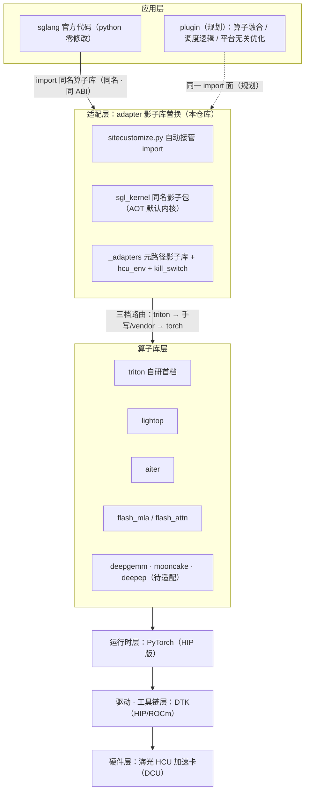

# 架构总览：影子库替换的协调关系

> 本文是架构一页图的文字版（图源：仓库根 [architecture.html](../architecture.html)），
> 讲清 sglang / plugin / adapter / lightop / aiter / mooncake / deepep / deepgemm
> 之间的关系。环境变量见 [env-vars.md](env-vars.md)，实测模型记录见 [models.md](models.md)。

## 1. 定位与核心机制

让社区版 sglang 官方代码的 **python 部分零修改**、直接跑在海光 HCU（DCU/DTK，HIP 路径）上。

核心机制是**影子库替换**：对 sglang 直接引用的算子库（`sgl_kernel`、`aiter`、
`flashinfer`、`flash_attn`、vllm `_custom_ops` 等）不做调用点改造，而是由本仓库
提供同名/同 ABI 的影子实现并自动接管 import，官方代码拉下来就能跑。

影子替换能严丝合缝的原因：sglang 的统一算子层 `sglang.kernels`（RFC #29630 的
`BaseFusedOp` 多后端模型）在 HIP 平台上把 **AOT 后端**（`forward_aot` →
`import sgl_kernel`）作为默认内核路径（JIT triton 后端只注册给 CUDA）。因此提供
一个同名的 `sgl_kernel` 包，上游 sglang 零修改即可在 HCU 上解析到我们的内核；
其余 import 面（vllm 桥、vendor 库桩）由 `sitecustomize.py` 随进程自动接管。

算子实现不绑定特定后端，按**三档路由**：

1. **triton 先行**——先用 triton 实现，保证正确性（fp32 累加、GPU 路径禁主机同步）；
2. **手写优化 / vendor 封装**——对热点算子做极致优化，不追求自研：可直接封装
   lightop / aiter / flash_attn / flash_mla 等现有算子库；
3. **torch 兜底**——CPU 或不支持 dtype 走 torch 参考，保证 import 与调用永不失败。

## 2. 核心优势

| # | 优势 | 说明 |
|---|---|---|
| ① | 非侵入式维护 · 新模型急速适配 | 影子库与官方 sglang 版本更新**解耦**：升级只对齐算子接口；新模型补齐缺失算子即可急速拉起 |
| ② | 开箱性能 | 官方代码拉起即走 triton / vendor 优选内核，零改造获得可用性能；热点算子持续优化，默认路径越跑越快 |
| ③ | 质量把控集中 | 质量面收敛在 adapter 一层：CI/UT 只测 adapter（契约对拍 + CUDA-graph 回归 + 快关门禁）；**adapter 全绿 ⇒ 官方 sglang 可用** |

## 3. 软件分层

从上到下按软件层画，上层应用、下层支撑：

| 层 | 内容 | 备注 |
|---|---|---|
| 应用层 | **sglang 官方代码**（python 零修改）＋ **plugin**（规划） | plugin：算子融合 / 调度逻辑优化 / 硬件平台无关的优化 |
| 适配层 | **adapter 影子库替换层**（本仓库）：`sitecustomize.py` ＋ `sgl_kernel` 同名影子包 ＋ `_adapters` 元路径影子库 | 三档实现路由；配合 skill（`hcu-adapter-dev`）快速排查定位精度问题 |
| 算子库层 | triton（自研首档）· lightop · aiter · flash_mla / flash_attn · deepgemm（待适配）· mooncake / deepep（待适配） | 见 §4 逐项说明 |
| 运行时层 | **PyTorch（HIP 版）** | 张量计算 · 显存管理 · kernel launch；三档中的 torch 兜底也在这层 |
| 驱动 · 工具链层 | **DTK（DCU Toolkit）** | HIP/ROCm 软件栈：驱动 · 编译器 · 运行时 |
| 硬件层 | **海光 HCU 加速卡（DCU）** | 驱动以下才算硬件；gfx93\* 等 arch 探测驱动 adapter 自动裁决 |



## 4. 组件协调关系

### 适配层三组件（本仓库）

| 组件 | 职责 | 与其他组件的关系 |
|---|---|---|
| `sitecustomize.py` | PYTHONPATH 自动加载的 import 接管层 | 桥接 vllm `_custom_ops` 的 `rms_norm` / `fused_add_rms_norm`（HIP 6 参形态）到 `sgl_kernel`；`apply_token_bitmask_inplace_cuda` → sglang 仓内 triton；flashmla backend 的 flashinfer wrapper 构造桩；int8/fp8 量化路径重绑定（slimquant 等） |
| `sgl_kernel/` | 同名影子包 = `sglang.kernels` 的 AOT 默认内核路径 | elementwise / layernorm / rope / moe / `gemm_fp8`·`gemm_int8` / `flash_mla` emu / `kvcacheio`；API 逐字对齐官方 sgl-kernel；内部按三档路由取 triton / vendor / torch |
| `sgl_kernel/_adapters/` | 元路径影子库（import hook） | `aiter` 真包优先 + 缺口填空；`flashinfer` / `flash_attn` 桩（import 成功、调用响亮报错）；`hcu_env` 环境注册表、`kill_switch` 快关；slimquant / mqa_logits_emu / dsa_topk 等模型级补丁 |

### 算子库层

| 算子库 | 现状 | 说明 |
|---|---|---|
| triton | 自研首档 | 基础算子 triton 起步；fp32 累加、零主机同步；持续手写优化（如 moe gate triton 化排期中） |
| lightop | vendor 封装 | `fuse_silu_and_mul` 已接：`HCU_SILU_MUL_IMPL=lightop` 显式启用，A/B + 图重放压测及格后转正 auto |
| aiter | DTK wheel | 真包优先、桩填空（`fused_clamp_act_mul` / `cp_gather_indexer_k_quant_cache` / `pa_mqa_logits` re-export 等）；custom all-reduce gfx93* 自动拒用（`HCU_AITER_AR=1` 夺回）、`aiter_fa` 快关 |
| flash_mla / flash_attn | emu + 桩 | **fa3 / flashmla 为目标方案**；当前 flash_mla 以 torch emu 顶住（decode=flashmla 后端已首验通过），flash_attn 桩 + 高危压测快关 |
| deepgemm | 待适配 | fp8 paged mqa_logits 经 aiter 桩 re-export；fp8 GEMM 走 `gemm_fp8` triton，本体待接 |
| mooncake | 待适配 | PD 分离/分层 KV transfer 的 `transfer_kv_*` 契约由 `sgl_kernel/kvcacheio.py` torch 移植顶住调用面，mooncake 本体待接 |
| deepep | 待适配 | MoE EP 通信库，仓库内尚无落点（TP1 单机绕过），多卡 EP 时再评估 |

### plugin（规划）

与 adapter 分工：adapter 致力于「官方代码拉下来就能跑」（三档实现，配合 skill
快速排查定位精度问题）；**plugin 承接算子融合 / 调度逻辑优化 / 硬件平台无关的
优化**，追求极致的性能优化，完成后经**同一 import 面**替换 / 增强默认路径。

## 5. 横切机制

- **环境变量注册表**（`hcu_env.py`）：显式 env > 自动规则（arch/wheel 探测）> 默认值；
  启动日志打印每个生效值及来源，正确部署零环境变量。手册见 [env-vars.md](env-vars.md)。
- **快关**（`kill_switch.py`）：`HCU_DISABLE_OPS=aiter_ar,aiter_fa` 一翻开关绕开
  疑似算子复跑，高危 vendor 算子接入即配压测 + 快关。
- **质量设施**：契约对拍官方 CUDA 核语义（gate 排序/tie-break、padding/cumsum 契约）、
  CUDA-graph capture-replay 变输入探针、精度问题四级快速定位
  （`tests/tools/run_triage.py`）。开发规约见
  [skills/hcu-adapter-dev/SKILL.md](../skills/hcu-adapter-dev/SKILL.md)。

## 6. 运行时调用链

```
python -m sglang.launch_server
  └─ PYTHONPATH = hcu-sglang-adapter : sglang/python
       └─ sitecustomize.py 自动加载（hcu_env 打印生效变量汇总）
            └─ sglang.kernels（BaseFusedOp）--forward_aot--> sgl_kernel 影子包
                 ├─ triton 自研核（首档）
                 ├─ vendor 封装（lightop / aiter / flash_mla …，hcu_env + 快关门控）
                 └─ torch 兜底
            └─ 其余 import 面：_adapters 元路径桩接管 aiter / flashinfer / flash_attn
                 └─ PyTorch（HIP）→ DTK（驱动·编译器·运行时）→ 海光 HCU（DCU）
```
